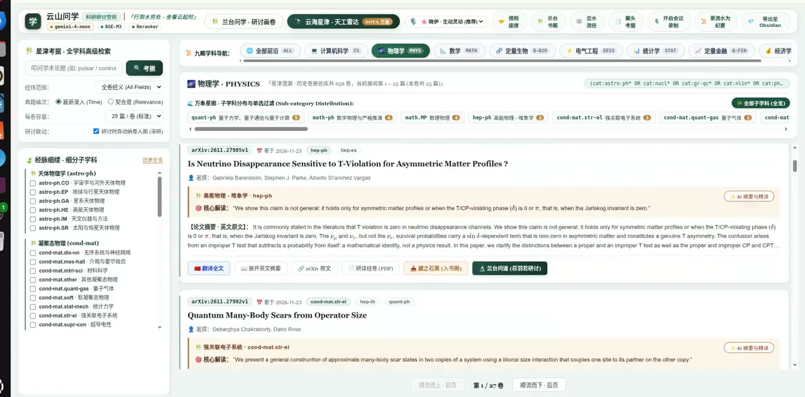
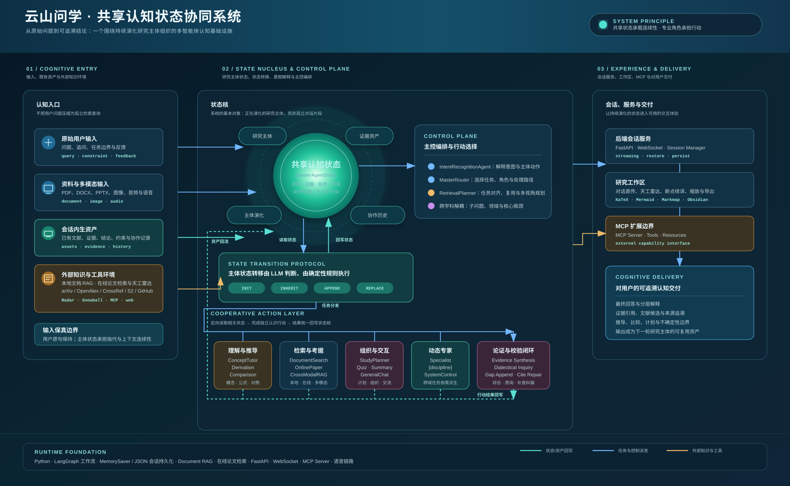

<div align="center">

# 🏛️ TianGong Academic Agent (云山问学 · 天工科研学术智能体)

**An Autonomous, Dialectical Multi-Agent System for Deep Academic Discovery, Resilient Multi-Source Retrieval, Local Privacy-Preserving RAG, and Paper Reproduction.**

[](https://www.python.org/)
[](LICENSE)
[](https://github.com/langchain-ai/langgraph)
[-purple)](https://modelcontextprotocol.io/)
[](https://github.com/cqf8635/tiangong-academic-agent)

[**English**](./README.md) | [**简体中文**](./README.md#中文说明) | [**🎬 Demo Video / 演示视频**](./docs/demo/tiangong_demo.mp4)

</div>

---

## 🎬 Demo Video / 系统实机演示

Click the preview below to view or download the full 2m31s walkthrough (`1280×632` H.264 MP4, compressed from the original 106MB screen recording for fast loading):

[](./docs/demo/tiangong_demo.mp4)

> 🔗 Direct video file: [docs/demo/tiangong_demo.mp4](./docs/demo/tiangong_demo.mp4) (or raw stream: [Watch / Download MP4](https://github.com/cqf8635/tiangong-academic-agent/raw/main/docs/demo/tiangong_demo.mp4))

---

## 🌟 Overview / 系统概览

**TianGong Academic Agent (云山问学)** is a production-grade, state-machine-driven multi-agent research workbench tailored for researchers, scientists, and graduate students. Rather than a thin LLM chat wrapper, it focuses on **reusable engineering patterns** for real-world academic research bottlenecks:

- 🧭 **TianGong Academic Radar (8 Disciplines & 150+ Subcategories)**: Daily preprint tracking across Physics, CS, Math, Bio, Finance, and Economics with a **4-tier resilient fallback chain**: `arXiv Daily RSS → arXiv API → OpenAlex arXiv-indexed Works (Polite Pool) → Local Snapshot`, automatically handling weekend announcement pauses and rate limits.
- 🔒 **100% Local Privacy-Preserving Neural Models**: Embedding (`BGE-M3`), Cross-Encoder Reranking (`BGE-Reranker-v2-m3`), and Speech-to-Text (`Whisper-Large-v3`) run entirely **on your local GPU/CPU**, ensuring unpublished manuscripts, proprietary PDFs, and lab recordings stay on your machine.
- 🔁 **Stateful Subject Memory & Task Alignment**: Explicit `MasterAgentState` (`topic_state`, `subject_entity`, `subject_evolution_log`, `shared_pool`) paired with pre-retrieval `task_alignment` verification prevents topic drift and erroneous external searches across multi-turn research sessions.
- ⚔️ **Dialectical Review & Gap-Retrieval Loop**: Separates *Retrieval Planner* → *Domain Author* → *Zero-Token Evidence Synthesis* → *Dialectical Peer-Reviewer* → *Targeted Gap Retrieval* → *Append-Only Evidence Refinement* to eliminate hallucinations without degrading previously verified prose.
- 🌐 **Multi-Source Heterogeneous Discovery & Citation Snowballing**: Concurrently probes **arXiv + OpenAlex + CrossRef + Semantic Scholar + DBLP + GitHub + Web** under a unified time budget, with per-source cooldown circuit breakers, **Citation Snowballing** along seed citation graphs, non-peer-reviewed repository downweighting (Zenodo / Figshare / OSF), and **BGE-M3 + BGE-Reranker + MMR** two-stage ranking.
- 🛡️ **Deterministic Guardrails & Zero-Cost Citation Consistency**: Post-processing automatically repairs drifted `[n]` framework citations, expands multi-citation brackets, renumbers citations to contiguous `1..K` order, and syncs right-panel evidence cards—plus safe fenced-JSON / LaTeX backslash parsing, Mermaid 600% pan-zoom, Markmap multi-scope mindmaps, and Obsidian Vault/Canvas export.
- 📄 **Full-Format Direct Upload & Resumable Paper Translation**: Upload PDF / Word / PPT / EPUB / LaTeX / Markdown / TXT directly in the chat bar (full-document context routing up to 120k chars, semantic RAG fallback for book-length files), auto-sync high-relevance online papers into local ChromaDB with TTL/cap pruning, and translate full papers chunk-by-chunk with persistent resumable caching (`chunks_zh`) on a dedicated fast model (`TRANSLATION_LLM_MODEL`).

---

## 💾 Local Models & Privacy / 本地模型体系与科研数据安全

TianGong adopts an **on-premise hybrid neural architecture**: reasoning and translation calls route to your configured OpenAI-compatible LLM endpoints, while all document embeddings, semantic reranking, and voice transcription run strictly locally:

| Function | Model | Default Local Path | Key Characteristics |
| :--- | :--- | :--- | :--- |
| **Dense Embedding** | `BAAI/bge-m3` | `./models/embedding` | 1024-dim semantic vector representation; 100% local, 0 API cost |
| **Cross-Encoder Reranker** | `BAAI/bge-reranker-v2-m3` | `./models/reranker` | Fine-grained semantic relevance scoring with cosine fallback |
| **Speech-to-Text (ASR)** | `whisper-large-v3` | `./models/whisper-large-v3` | Offline CUDA voice transcription for queries and lab meeting logs |

---

## 🏗️ System Architecture / 核心架构



---

## 🚀 Quick Start / 快速上手

### 1. Clone & Environment Setup / 克隆并配置环境

```bash
git clone https://github.com/cqf8635/tiangong-academic-agent.git
cd tiangong-academic-agent

conda create -n tiangong python=3.12 -y
conda activate tiangong

pip install -r requirements.txt
```

### 2. Download Local Models / 下载本地私有化模型 (推荐)

```bash
# Download local BGE-M3 embedding and BGE-Reranker weights into ./models/
python download_vector_models.py all
```

> **Note on Whisper**: If using local voice input, download `whisper-large-v3` weights to `./models/whisper-large-v3` or point `WHISPER_MODEL_PATH` in `.env` to your existing directory.

### 3. Configure Environment Variables / 配置环境变量

```bash
cp .env.example .env
```

Edit `.env`:
```ini
# 1. Primary LLM API (supports any OpenAI-compatible endpoint)
OPENAI_API_KEY=your_actual_api_key_here
OPENAI_MODEL=your_preferred_model_name
OPENAI_BASE_URL=your_api_base_url_here
# Optional: fast fallback model for planner/retries
# OPENAI_FALLBACK_MODEL=your_fast_model
# LLM_TIMEOUT=180.0

# 2. Optional: Dedicated fast model for Radar abstract/full-paper translation
# TRANSLATION_LLM_MODEL=gemini-3.8-flash

# 3. Optional: Academic API Polite Pool & API Keys
# OPENALEX_MAILTO=your_email@example.com
# SEMANTICSCHOLAR_API_KEY=

# 4. Local Models
PAPER_EMBEDDING_MODEL=./models/embedding
PAPER_RERANKER_MODEL=./models/reranker
PAPER_USE_RERANKER=1
WHISPER_MODEL_PATH=./models/whisper-large-v3
```

### 4. Launch System / 启动服务

```bash
python run.py
```

Open your browser and visit **`http://127.0.0.1:8888`** (or **`http://localhost:8888`**).

---

<a name="中文说明"></a>
## 🇨🇳 中文核心特性与工程设计亮点

### 1. 多智能体状态机与辩证审校闭环 (`master_agent_workflow.py`)
- **任务对齐与主体记忆**：在触发外部检索前先对照用户原话做 `task_alignment` 核验，结合 `topic_state`、`subject_entity` 与 `SharedPool` 资产复用池，杜绝多轮对话跑偏与重复冗余检索；
- **生成与审校解耦**：构建 `检索规划 → 专家主研 → 纯代码证据归纳（0 Token）→ 辩证质询审校（Peer Reviewer）→ 缺口定向补查 → 增量追加` 闭环，避免多轮重写导致已核验内容退化。

### 2. 真实网络下的高可用多源检索与天工雷达 (`online_paper_search_agent.py`, `cross_source_hybrid_retriever.py`)
- **7+ 异构源并发 + 分级熔断**：并发检索 arXiv、OpenAlex、CrossRef、Semantic Scholar、DBLP、GitHub 与 Web，受统一时间预算约束；对 DBLP `202`、S2/arXiv `429`、瞬态 `502/503/504` 自动冷却或退避重试；
- **天工雷达四级容灾**：`arXiv 每日 RSS → arXiv 查询 API → OpenAlex arXiv 源（Polite Pool）→ 本地磁盘快照`，周末休刊或代理限流时自动无缝切换；
- **引文滚雪球 + 两级精排 + 降权去噪**：结合 `CitationSnowball` 沿引文图扩展相关工作、非同行评审自存档仓储降权（Zenodo/Figshare/OSF）、以及本地 `BGE-M3 + BGE-Reranker + MMR` 相关性与多样性联合排序。

### 3. 全格式文档直传解析与本地知识库治理 (`document_rag_engine.py`, `backend_api.py`)
- **对话框直接上传解析**：支持 PDF / Word / PPT / EPUB / LaTeX / Markdown / TXT 随提问上传，12 万字以内全文上下文直通无遗漏，超长巨著自动切换语义精排；
- **在线论文自动沉淀与生命周期管理**：高相关检索文献自动沉淀入本地 ChromaDB（`online_synced_paper`），配套引用优先、TTL 过期淘汰、上限裁剪与侧边栏一键清理；
- **分块断点续译**：天工雷达“精译”与“翻译全文”支持独立快速翻译模型（`TRANSLATION_LLM_MODEL`）与分块缓存（`chunks_zh`），单块超时仅补跑失败块。

### 4. 确定性工程兜底与学术工作台体验 (`retrieval_planner.py`, `static/js/app.js`)
- **零成本引用漂移纠偏与连续重排**：后处理自动隔离数学公式（防止 `$[0, 1]$` 误伤），依据唯一框架/论文锚点纠正长文漂移编号、展开 `[7, 9]` 合并括号并按首次出现顺序重排为连续 `1..K`，同步联动正文 `[n]` 点击跳转至右侧证据原图快照；
- **排版与可视化增强**：内置 KaTeX 数学渲染、arXiv 裸排版宏清洗（`\texttt` / `\emph` / `<tt>`）、Mermaid 矢量架构图 **600% 拖拽缩放与 SVG 导出**、Markmap 多视角知识导图（本轮/全书/全景）、以及 Obsidian 双链与 Canvas 导出。

---

## 🔌 MCP (Model Context Protocol) 集成

本项目通过 [`mcp_server.py`](mcp_server.py) 原生支持 **Model Context Protocol (MCP)**，可在 Claude Desktop、Cursor 等客户端挂载为外部学术大脑：

```json
{
  "mcpServers": {
    "tiangong-academic": {
      "command": "python",
      "args": ["/path/to/tiangong-academic-agent/mcp_server.py"]
    }
  }
}
```

---

## 🧪 Testing & Verification / 自动化测试

项目包含 20+ 个单元测试套件，覆盖检索韧性、任务对齐、引用纠偏重排、共享池、雷达调度与工作流契约：

```bash
PYTHONPATH=. pytest -q tests/test_arxiv_resilience.py tests/test_retrieval_planner.py tests/test_radar_sync_scheduler.py
```

---

## 📄 License / 开源协议

This project is licensed under the **Apache License 2.0** - see the [LICENSE](LICENSE) file for details.
