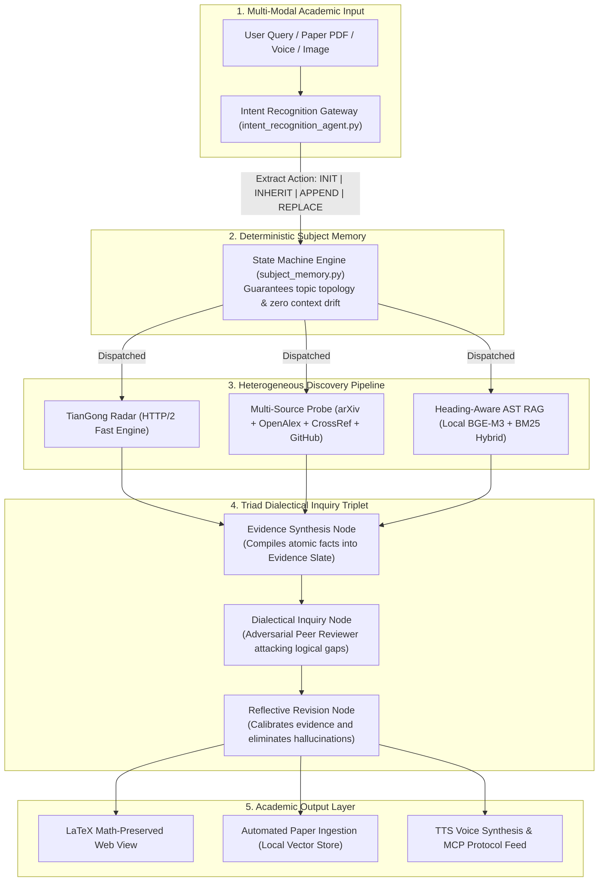

<div align="center">

# 🏛️ TianGong Academic Agent (天工科研学术智能体)

**An Autonomous, Dialectical Multi-Agent System for Deep Academic Discovery, Local Privacy-Preserving RAG, and Paper Reproduction.**

[](https://www.python.org/)
[](LICENSE)
[](https://github.com/langchain-ai/langgraph)
[-purple)](https://modelcontextprotocol.io/)
[](https://github.com)

[**English**](./README.md) | [**简体中文**](./README.md#中文说明)

</div>

---

## 🌟 Overview / 系统概览

**TianGong Academic Agent** is a production-grade, state-machine-driven multi-agent framework tailored for researchers, scientists, and graduate students. Unlike typical chat-wrapper interfaces, TianGong solves real-world academic research bottlenecks:

- 🧭 **Academic Radar (8 Disciplines & 150+ Subcategories)**: Instant daily preprint tracking across Physics, CS, Math, Bio, Finance, and Economics.
- 🔒 **100% Local Privacy-Preserved Models**: Embedding (`BGE-M3`), Reranking (`BGE-Reranker`), and Speech Transcription (`Whisper-Large-v3`) run entirely **on your local machine**, ensuring unreleased manuscripts, proprietary PDFs, and research discussions never leave your hardware.
- 🔁 **Deterministic State-Machine Subject Memory**: Completely decouples LLM soft reasoning from hard state transitions ($S_t \rightarrow S_{t+1}$), permanently eliminating **Topic Drift** during multi-turn research inquiries.
- ⚔️ **Triad Dialectical Triplet**: Integrates a built-in *Peer-Reviewer* agent performing adversarial cross-examination before synthesizing conclusions, eradicating hallucinations.
- ⚡ **HTTP/2 Resilient arXiv Engine**: Uses an atomic, mutex-scheduled HTTP/2 transport layer (~0.87s latency), solving the dreaded arXiv rate-limit (Tarpit) socket timeouts.
- 🔬 **Code-Literature Companion Probe**: Concurrently queries **arXiv + CrossRef + OpenAlex + GitHub API**, delivering papers alongside their official implementation repositories, citation counts, and conference venues.
- 📐 **Heading-Aware AST Parsing & LaTeX Math Isolation**: Safeguards mathematical derivations, formulas, and proofs against Markdown rendering corruption.

---

## 💾 Local Models & Privacy / 本地模型体系与科研数据安全

TianGong adopts an **on-premise hybrid neural architecture**: only reasoning calls are routed to the user's chosen LLM, while all document embeddings, vector rerankings, and speech transcriptions run strictly on your local GPU/CPU:

| Function | Model | Default Local Path | Key Characteristics |
| :--- | :--- | :--- | :--- |
| **Dense/Sparse Embedding** | `BAAI/bge-m3` | `./models/embedding` | 1024-dim multi-granularity vector representation; 100% local, 0 external API cost |
| **Cross-Encoder Reranker** | `BAAI/bge-reranker-v2-m3` | `./models/reranker` | Deep semantic relevance scoring; equipped with auto-fallback to cosine metric |
| **Speech-to-Text (ASR)** | `whisper-large-v3` | `./models/whisper-large-v3` | High-fidelity offline voice transcription; lab meeting recordings stay strictly confidential |

---

## 🏗️ System Architecture / 核心架构



---

## 🚀 Quick Start / 快速上手

### 1. Clone & Environment Setup / 克隆并配置环境

```bash
# Clone the repository
git clone https://github.com/cqf8635/tiangong-academic-agent.git
cd tiangong-academic-agent

# Create virtual environment (Python 3.11 or 3.12 recommended)
conda create -n tiangong python=3.12 -y
conda activate tiangong

# Install complete dependencies
pip install -r requirements.txt
```

### 2. Download Local Models / 下载本地私有化模型 (推荐)

Use the built-in downloader script to automatically fetch the local embedding and reranker models into `./models/`:

```bash
# Download both BGE-M3 embedding and reranker snapshots
python download_vector_models.py all
```

> **Note on Whisper**: If using local voice input, download `whisper-large-v3` weights to `./models/whisper-large-v3` or point `WHISPER_MODEL_PATH` in `.env` to your existing model directory.

### 3. Configure Environment Variables / 配置环境变量

Copy the template and fill in your LLM API credentials (compatible with OpenAI standard protocol):

```bash
cp .env.example .env
```

Edit `.env`:
```ini
# 1. LLM API (supports any OpenAI-compatible endpoint)
OPENAI_API_KEY=your_actual_api_key_here
OPENAI_MODEL=your_preferred_model_name  # e.g., gemini-3.8-flash, gpt-6.1-sol, ...
OPENAI_BASE_URL=your_api_base_url_here  # e.g., https://api.openai.com/v1

# 2. Local Models (relative or absolute paths)
PAPER_EMBEDDING_MODEL=./models/embedding
PAPER_RERANKER_MODEL=./models/reranker
PAPER_USE_RERANKER=1
WHISPER_MODEL_PATH=./models/whisper-large-v3
```

### 4. Launch System / 启动服务

```bash
python run.py
```
Open your browser and navigate to: **`http://127.0.0.1:8008`** (or **`http://localhost:8008`**)

---

<a name="中文说明"></a>
## 🇨🇳 中文核心功能特性

### 1. 100% 私有化本地神经模型体系 (零数据泄露)
- **学术资料零上传**：学术论文 PDF、未发表的阶段性草稿、内部研讨语音的向量切片与特征提取**全部在本地 GPU/CPU 上运行**；
- **BGE-M3 (Dense + Sparse 混合多粒度检索)**：兼顾长文本语义泛化与特定专业术语、定理符号的精准定位；
- **Whisper-Large-v3 离线语音识别**：会议录音与语音提问完全在本地离线转录，杜绝录音数据流向外部商业云平台。

### 2. 确定性学术主体记忆状态机 (`subject_memory.py`)
- **告别传统对话 RAG 的上下文漂移（Topic Drift）**；
- 大模型仅负责提炼语义动作（`INIT` 首轮确立 / `INHERIT` 隐式继承 / `APPEND` 多主题对比 / `REPLACE` 显式重置）；
- 底层由 Python 状态机严格维护数学状态跃迁 $S_t \rightarrow S_{t+1}$ 与 `evolution_path`，多轮研讨无需冗余历史 Token 堆叠即可实现零偏离聚焦。

### 3. 模拟顶刊审稿人的“三元辩证对抗环” (`master_agent_workflow.py`)
- 摒弃业界线性“检索即生成”的单向脆弱性；
- 构建了 `证据归纳专员` $\rightarrow$ `辩证质询专员 (Peer Reviewer)` $\rightarrow$ `主研反思重构专员` 的自省闭环；
- 在学术论点输出前主动寻找逻辑跳跃、过度外推与证据孤岛，把**同行评议挑刺作为原生抗幻觉防线**。

### 4. 物理单并发与 HTTP/2 极速调度器 (`ArxivScheduler`)
- 针对 arXiv 官方严格的反爬限流与 Tarpit 慢速惩罚防火墙；
- 采用 Socket 互斥锁 + I/O 完成闭环校验 + **系统级 HTTP/2 传输通道（实测延迟仅 ~0.87s）**；
- 具备后台同步任务感知前台交互的**主动让行退避（Yielding）机制**与双层熔断保护。

### 5. 预印本-同行评议-开源代码一体化“伴生探针”
- 并发探查 **arXiv**（最新预印本）、**CrossRef / OpenAlex**（权威录用、被引量）、**Europe PMC / INSPIRE-HEP**（生物医药/物理顶刊）、**GitHub API**（官方开源实现、Stars 趋势）；
- 彻底解决科研人员“读懂了顶会论文，却找不到官方或高质量开源代码复现”的断层痛点。

### 6. 格式与排版严密防护
- **Heading-Aware 语法 AST 切片**：依据章节目录树（`#`, `##`, `###`）保护公式块与表格为“不可分割原子块”，保留章节面包屑；
- **双阶段 LaTeX 隔离状态机**：利用 `@MATHBLOCK_` 哈希隔离符，彻底解决 Markdown 渲染器将公式下划线 `_` 误伤为斜体导致排版破碎的问题。

---

## 🔌 MCP (Model Context Protocol) 集成

本项目通过 [`mcp_server.py`](mcp_server.py) 原生支持 Anthropic 推出的 **Model Context Protocol (MCP)**。

可在 Claude Desktop、Cursor 等工具的 `claude_desktop_config.json` 中轻松挂载本系统为外部学术大脑：

```json
{
  "mcpServers": {
    "tiangong-academic": {
      "command": "python",
      "args": ["/path/to/tiangong-academic-agent/mcp_server.py"]
    }
  }
}
```

---

## 🧪 Testing & Verification / 自动化测试

运行全套韧性与抗网络波动单元测试：

```bash
PYTHONPATH=. pytest tests/test_arxiv_resilience.py
```

---

## 📄 License / 开源协议

This project is licensed under the **Apache License 2.0** - see the [LICENSE](LICENSE) file for details.
