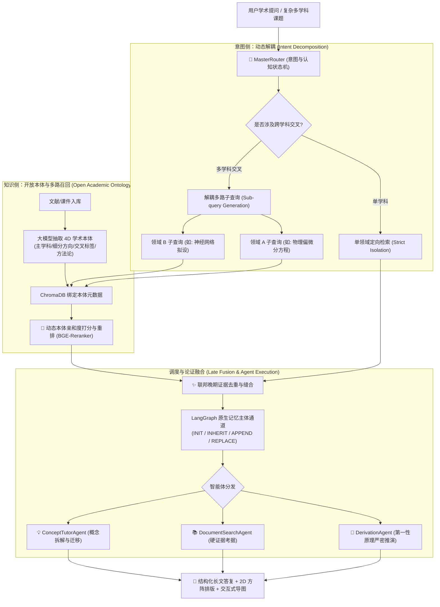

# 🏛️ 《云山问学》多智能体科研研讨与开放本体检索系统
## —— 架构设计思想、方法论演进与通用项目复用参考手册

> **编制版本**：v2.0 终极学术与工程全景典藏版  
> **核心定位**：从 0 到 1 构建高精度、抗噪声、支持前沿科学推演与跨学科解耦的生产级多智能体系统（Multi-Agent RAG System）  
> **适用场景**：AI for Science（物理/生物/化学）、工业高精仿真、金融多维风控、法律跨法条推理、复杂企业级异构知识库

---

## 目录（Table of Contents）
1. [一、 核心痛点与问题空间定义（Why This Architecture?）](#一-核心痛点与问题空间定义)
2. [二、 顶层双螺旋架构设计（The Dual-Helix Methodology）](#二-顶层双螺旋架构设计)
3. [三、 知识侧：开放式学术本体抽取与动态亲和度矩阵](#三-知识侧开放式学术本体抽取与动态亲和度矩阵)
4. [四、 意图侧：跨学科查询动态解耦与联邦晚期融合](#四-意图侧跨学科查询动态解耦与联邦晚期融合)
5. [五、 认知通道：LangGraph 原生主体状态机与记忆自洽](#五-认知通道langgraph-原生主体状态机与记忆自洽)
6. [六、 知识论证：硬证据考据（Hard Grounding）与软理论迁移（Soft Derivation）](#六-知识论证硬证据考据与软理论迁移)
7. [七、 渲染与展示层：语法树隔离与高维方阵保真协议](#七-渲染与展示层语法树隔离与高维方阵保真协议)
8. [八、 通用工程模式提炼与跨项目复用检查清单（Reusability Playbook）](#八-通用工程模式提炼与跨项目复用检查清单)

---

## 一、 核心痛点与问题空间定义

在构建面向专业科研、复杂工程或垂直领域的 AI 辅助系统时，传统的 Naive RAG（朴素检索增强生成）与单体 Agent 必然遭遇以下四大**“系统性死穴”**：

```
                               ┌── 痛点 1: 密集向量的“跨领域语义污染”（问量子力学召回大模型书籍）
                               ├── 痛点 2: 硬编码分类在“前沿交叉领域”的彻底失效（PINN、Bio-AI）
【传统 RAG 与 Agent 的五大死穴】──┼── 痛点 3: 0 到 1 原创科研在“公开数据集”上的绝对真空
                               ├── 痛点 4: 暴力“指代消解/查询改写”对高维专业语义的扭曲与污染
                               └── 痛点 5: 多轮交互中的“检索健忘症”（反复全网盲搜，忽略手头已有资产）
```

### 1.1 痛点剖析与实证
1. **跨领域语义污染（Cross-Domain Hallucination Pollution）**：
   - 传统密集向量（Dense Embeddings）在捕捉高维概念时，由于词共现特性（如“模型”、“状态”、“空间”在物理与计算机中频繁同现），当知识库同时存在多学科书籍时，提问“量子态约化”极易召回“大语言模型上下文窗口”的切片。
2. **硬编码分类的脆弱性**：
   - 依赖预设关键词字典（如 `if 'quantum' in text: physics`）完全无法应对前沿交叉学科（如 *Physics-Informed Neural Networks, Quantum Machine Learning, Cryo-EM Protein Folding*）。
3. **原创性探索的数据真空（The Zero-Data Dilemma）**：
   - 真正具备突破性的前沿想法在公开 Kaggle/GLUE 数据集上根本不存在现成评测集，系统必须具备**不依赖外部数据、依托第一性原理（First Principles）与公理自洽推演**的能力。
4. **指代消解与查询改写的致命扭曲（Query Rewriting Corruption）**：
   - 传统系统迷信“指代消解（Coreference Resolution）”，试图将用户简短自然的追问（如“它的第二步推导”）强行改写拼接成长句。这在包含密集数学符号、前沿物理概念或哲学思辨的场景下，极易引入**符号幻觉、术语错位与伪关系编造**，严重破坏严谨性。
5. **检索健忘症与会话内生资产割裂（Search Amnesia）**：
   - 传统 RAG 在多轮研讨中无法有效留存前序召回的学术成果。当用户在第 2 轮提出“从刚才的论文中筛选顶刊”时，系统无法感知手头已有资产，反而陷入重复调用搜索引擎的死循环，造成高延迟与外源反爬阻断。

---

## 二、 顶层双螺旋架构设计

为了彻底根治上述痛点，我们设计了**【知识侧层次化本体 + 意图侧跨学科解耦 + 联邦晚期融合】**的双螺旋架构：



---

## 三、 知识侧：开放式学术本体抽取与动态亲和度矩阵

### 3.1 零硬编码的四维本体结构定义（`DocumentAcademicOntology`）
入库时，彻底废弃关键词匹配，由大模型深度阅读文档核心章节，输出标准结构化 Pydantic 模型：

```python
class DocumentAcademicOntology(BaseModel):
    primary_discipline: str = Field(
        description="最核心的一级主学科 (如: 凝聚态物理, 结构生物学, 流体力学, 计算机科学...)"
    )
    sub_fields: List[str] = Field(
        default_factory=list,
        description="具体的细分研究方向 (如: ['双体量子纠缠', 'von Neumann 熵', '退相干动力学'])"
    )
    interdisciplinary_tags: List[str] = Field(
        default_factory=list,
        description="跨学科交叉标签 (如: ['量子信息', '微分几何', '神经网络拟合'])"
    )
    core_methodologies: List[str] = Field(
        default_factory=list,
        description="核心方法论与理论工具 (如: ['偏迹运算', 'Lindblad 耗散主方程', 'Ritz 变分法'])"
    )
```

### 3.2 动态亲和度打分与物理隔离矩阵（Semantic Affinity Matrix）
在检索召回（Search & Rerank）阶段，将元数据中的本体标签与查询意图进行多级语义对齐：

$$\text{FinalScore} = \text{RerankScore} + \Delta_{\text{affinity}}$$

其中亲和度增益/惩罚规则如下：
*   **主学科完全匹配 或 命中交叉标签**：$\Delta_{\text{affinity}} = +0.25$（强力提升置信度）；
*   **命中同源细分方向或方法论**：$\Delta_{\text{affinity}} = +0.15$；
*   **主学科明确冲突且无交叉标签（如计算机 vs 纯量子物理）**：$\Delta_{\text{affinity}} = -0.30$（压制异构噪音）；
*   **硬截断门槛**：最终得分必须满足 $\ge 0.35$，低于该阈值的切片一律剔除，彻底杜绝“垃圾切片污染”。

---

## 四、 意图侧：跨学科查询动态解耦与联邦晚期融合

### 4.1 复合查询的自动解耦机制
当用户提出诸如 *“我想设计一套基于物理信息神经网络（PINN）求解不可压缩 Navier-Stokes 方程的方案”* 时，系统自动识别出其跨学科属性：

```json
{
  "is_cross_disciplinary": true,
  "disciplines": ["physics", "llm_ai"],
  "sub_queries": [
    {
      "discipline": "physics",
      "query": "不可压缩 Navier-Stokes 方程 控制方程 连续性方程 边界条件 初始条件 物理守恒约束"
    },
    {
      "discipline": "llm_ai",
      "query": "physics-informed neural networks PINN 不可压缩流动 压力速度耦合 损失函数 采样策略 网络架构训练优化"
    }
  ]
}
```

### 4.2 多路并行检索与联邦晚期融合（Late Fusion Pipeline）
1. **多路并发派发**：各子查询携带各自的学科偏置，分别向本地 Chroma 向量库、arXiv 线上预印本库、CrossRef 学术出版库发起并发检索；
2. **跨源去重与语义缝合**：
   - 依据 `(doc_name, page_index)` 或全局哈希进行去重；
   - 按照加权综合得分对多学科切片进行重排；
   - 生成统一的黄金证据链（Golden Evidence Chain），一次性注入执行智能体，杜绝信息碎片化。

---

## 五、 认知通道与意图感知：基于运行时全息状态镜像的零改写（Zero-Rewriting）多轮路由机制

这是本系统最具学术与工程突破性的**核心创新方法论**。我们彻底颠覆了“改写用户句子”的传统套路，提出了**【零指代重写、现场即认知（Situational State as Context）】**的全新范式。

```
【LangGraph 全息状态现场】
┌─────────────────────────────────────────────────────────────┐
│ 1. 核心研究主体 (active_subject)   : 【量子场论非微扰格点模拟】     │
│ 2. 聚焦研读经卷 (active_doc)       : 《Roadmap_Metasurface.pdf》   │
│ 3. 已就绪文献资产池 (recent_candidates): 6 篇结构化论文元数据       │
│ 4. 长期全息沉淀 (history_summary)  : 核心定理、公式与学术红线      │
└──────────────────────────────┬──────────────────────────────┘
                               │ 原生结构化投射 (~200 Tokens, 零截断损失)
                               ▼
            ┌────────────────────────────────────┐
            │   🧠 意图大模型 (State-Grounded)    │
            │   用户原始输入 100% 原汁原味纯净    │
            └──────────────────┬─────────────────┘
                               │ 自适应分流决策
             ┌─────────────────┴─────────────────┐
             ▼                                   ▼
    【内生资产闭环运算】                  【外向开拓探索探测】
    - 状态中已有资产 (Papers/Docs)         - 状态中资源空虚或全新领域
    - 进行横向筛选/分类/对比/求精          - 激活多路引擎向外检索
    - need_online_search = False         - need_online_search = True
    - 0 冗余全网重复请求                 - 产出新文献沉淀入 LangGraph
```

### 5.1 零改写无偏见记忆哲学（The Zero-Rewriting Principle）
*   **拒绝暴力改写**：用户的提问无论多么简短（如“第二步怎么做？”、“从刚才的论文里挑出预印本”），都**严格保持 100% 原文不变**，杜绝任何将短句暴力膨胀为拼凑句的“指代消解算法”；
*   **状态通道隐式承载**：依托 LangGraph 原生状态通道的四态演进机制（`INIT` / `INHERIT` / `APPEND` / `REPLACE`），当 `subject_action == 'INHERIT'` 时，下游推导与检索节点自适应继承锁定的锚点主体，不依赖文字篡改。

### 5.2 状态现场作为第一公民（State-Native Situational Reflection）
*   **告别文本摘要的脆弱截断**：避免将复杂的文献列表、公式定理压缩为一段容易被截断（`[:350]`）且容易丢失细节的自由文本；
*   **结构化高保真直达**：意图解析函数直接以全局大脑状态 `state: MasterAgentState` 为输入，在提示词中高保真投影当前研讨现场的客观事实：
    - `active_subject`：当前主干研究方向与演化深度；
    - `active_doc`：当前专精精读的文献；
    - `recent_paper_candidates`：前序已由外网检索入库的结构化论文列表（含标题、年份、出处、DOI）；
    - `history_summary`：跨轮次积累的理论公理与不可违背的负向约束。

### 5.3 内生资产运算与外向探索的自适应判别
彻底解决商业科研 Agent 的“检索健忘症”：
1. **内生资产运算（In-Session Asset Action）**：当状态中已有候选文献池，用户发起“筛选顶刊”、“对比实验方案”、“挑出综述”时，大模型自主识别当前存在就绪资产，输出 `need_online_paper_search: false`，工作流自动将候选资产全量装配进黄金证据链，实现零延迟、零网络消耗的闭环研判；
2. **外向开拓探测（External Exploratory Inception）**：当状态资产为空或研讨发生全局跃迁时，大模型自主判定 `need_online_paper_search: true`，触发全球外网多源检索。

### 5.4 跨学科认知拓扑的统一自洽（理工科学与人文学科普适同构）
本状态路由拓扑不仅在**理论物理、高能物理格点规范理论**等数理学科中运转严密，而且在**现代分析哲学、心灵哲学与模态逻辑**中得到了同构验证：
*   **概念谱系梳理**（如心灵哲学中关于“现象意识”与“解释鸿沟”的谱系论争） $\rightarrow$ 自动派发 `ConceptTutorAgent`，初始化研讨主体（`INIT`）；
*   **多学说横向批判**（如内格尔蝙蝠论证 vs 查尔默斯僵尸论证） $\rightarrow$ 自动派发 `ComparisonAgent`，无偏见继承主体（`INHERIT`），严禁外搜；
*   **严格形式演绎推导**（如双维语义学从认知可设想性向形而上学可能性的逻辑推演） $\rightarrow$ 自动识别哲学前提-结论演绎链条的严密性，精准派发 `DerivationAgent`。
证明了系统具备真正意义上的**开放学科科学认知与推演通用性**。

---

## 六、 知识论证：硬证据考据与软理论迁移

在严谨学术与工业级系统中，必须明确区分**两种截然不同的论证场景**：

| 维度 | 硬证据考据（Hard Grounding） | 软理论迁移 / 第一性原理推演（Soft Derivation） |
| :--- | :--- | :--- |
| **触发场景** | 用户明确询问特定文献、课件、实验数据或历史结论 | 用户要求公式严密证明、从零方案设计、或探讨无公开数据的前沿课题 |
| **数据源** | 物理检索器（BGE-M3 + Reranker）命中的高置信度切片（$\ge 0.35$） | 大模型深层参数化科学常识 + 第一性原理（物理守恒律、变分原理） |
| **输出形式** | 带有明确书籍出处、页码定位与原图快照的考据卡片 | 万字级数学符号推导、边界条件分析、损失函数构造与定理证明 |
| **容错设计** | 切片不足时，明确提示“未找到直接切片”，不胡编乱造 | 严格自洽，通过多智能体反向审查杜绝数理逻辑漏洞 |

---

## 七、 渲染与展示层：语法树隔离与高维方阵保真协议

前端数学与排版系统的稳定性直接决定了学术体验。本系统总结了两项关键的工业级渲染准则：

### 7.1 语法树隔离原则（AST Isolation Protocol）
*   **严禁在全局 Markdown 渲染器中滥用正则替换**：
    全局的括号替换（如试图拦截 `（formula）`）会直接破坏大模型输出中合法的 LaTeX 语法闭合（如 `\dim(\mathcal{H})`、`\begin{pmatrix}`）；
*   **用户气泡与 AI 回答区单向隔离**：
    对用户输入气泡的特殊格式化仅在 `sender === 'user'` 的局部作用域内执行，保持 AI 回答区使用标准抽象语法树（AST）与 KaTeX 渲染。

### 7.2 高维方阵二维保真协议（Matrix 2D Integrity）
*   **避免误杀 `\\` 换行符**：
    在数学解析器中，严禁执行 `.replace(/\\\\/g, '\\')`，必须完整保留 `\\`，确保 $4 \times 4$ 密度矩阵以标准二维方阵呈现：
    $$\rho_{AB} = \begin{pmatrix}
    \rho_{00,00} & \rho_{00,01} & \rho_{00,10} & \rho_{00,11} \\
    \rho_{01,00} & \rho_{01,01} & \rho_{01,10} & \rho_{01,11} \\
    \rho_{10,00} & \rho_{10,01} & \rho_{10,10} & \rho_{10,11} \\
    \rho_{11,00} & \rho_{11,01} & \rho_{11,10} & \rho_{11,11}
    \end{pmatrix}$$

---

## 八、 通用工程模式提炼与跨项目复用检查清单

当您在未来的其他项目（如金融风控、工业仿真、医疗问答、法律协同等）中需要搭建类似系统时，可直接对照以下**标准化实施清单（Playbook Checklist）**：

### 📋 跨项目复用清单（8 步落地法）
- [ ] **Step 1: 建立开放式领域本体结构**
  - 不使用写死的关键词字典，使用 Pydantic 定义 `primary_domain`, `sub_fields`, `cross_tags`, `methodologies`。
- [ ] **Step 2: 入库时大模型一次性元数据增强**
  - 文档/段落切片入库时，同步调用轻量 LLM 生成本体元数据并写入向量库。
- [ ] **Step 3: 意图路由器增加多领域解耦能力**
  - 在 Router Prompt 中增加跨领域分解指令，生成 `sub_queries` 数组。
- [ ] **Step 4: 实现带有本体亲和度惩罚的重排器**
  - 在重排打分后，依据领域匹配度施加 $+0.25$ / $-0.30$ 的浮动，设置 $\ge 0.35$ 纯净过滤门槛。
- [ ] **Step 5: 接入 LangGraph 构建主体状态通道**
  - 配置 `active_subject` 字段，实现 `INIT / INHERIT / APPEND / REPLACE` 四态演化。
- [ ] **Step 6: 配置双轨论证机制（硬检索 + 软推演）**
  - 检索成功时展示精确证据链；检索为空时无缝退化为第一性原理深度推导，拒绝低质胡编。
- [ ] **Step 7: 前端渲染管线解耦**
  - 确保 LaTeX 矩阵 `\\` 换行符不受转义损耗，用户输入与模型输出渲染环境独立。
- [ ] **Step 8: 静态代码与转义字符体检**
  - 确保 Python 3.12+ 提示词采用 `r"""` 原始字符串，Pydantic 全面升级至 `model_dump()`。

---

> 💡 **总结**：本架构通过**“开放本体代替硬编码、意图解耦代替单一检索、状态通道代替上下文堆叠、双轨论证代替生硬拼接”**，实现了高精度、强鲁棒、支持任意复杂科学与工程课题的通用多智能体推理系统。
