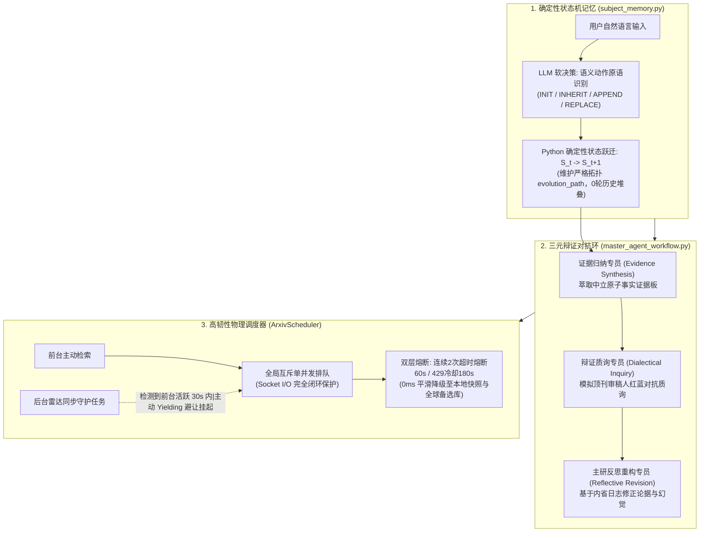

# 天工科研学术智能体系统：核心创新与技术独到性分析报告

> **编制日期**：2026-10-23  
> **核心主题**：对比全球主流 AI 学术助手（PaperQA2、OpenScholar、GPT-Academic、Stanford STORM、Elicit 等），系统性梳理本项目在底层架构、大模型状态机、多智能体协同与高可用学术调度等维度的**业界极少做或未被充分探索的独到创新**。

---

## 一、 执行摘要与行业基准对比（Executive Summary & Benchmark）

随着大语言模型（LLM）在科学研究与文献分析领域的渗透，目前业界已涌现出诸如 **PaperQA2（FutureHouse）**、**OpenScholar（UW / AI2）**、**GPT-Academic**、**Stanford STORM** 等代表性系统。然而，通过对上述系统底层架构与技术链路的真实调研，现有方案普遍存在以下深层痛点：
1. **多轮记忆严重漂移**：对话历史依赖纯文本总结或 Prompt 堆叠，3~5 轮后频繁发生主题偏移（Topic Drift）与核心学术主体被篡改；
2. **生成链路单向脆弱**：检索即生成、生成即交付，缺少问答生成过程中的“审稿人级红蓝对抗与辩证批判”机制；
3. **否定盲区与跨文献数据污染**：无法区分“仅借用论文框架结构”与“具体实验数据”，容易将跨文献事实混淆，且常常无视用户的负向排除指令；
4. **外部学术接口极易卡死**：对 arXiv 等具有严苛反爬（Tarpit 慢速惩罚/429）的学术源缺乏物理级并发控制与前后台协同避让，常引发长达数十秒的无底洞卡死与白屏；
5. **文献与工程代码生态割裂**：查论文与找代码完全脱节，研究人员“读了论文却找不到可复现的官方/第三方开源仓库”。

本项目在工程实现与算法设计上，针对上述瓶颈研发了 **6 项业界极少实现或完全原创的核心机制**，构建了兼具高学术严谨度与工业级高可用性的科研辅助中枢。

---

## 二、 六大独到核心创新深度剖析

---

### 创新点 1：确定性状态机与大模型推理彻底解耦的记忆引擎 (`subject_memory.py`)

#### 1. 业界普遍痛点
目前主流的对话式科研 RAG 架构（包括 MemGPT、LangChain 对话总结组件）对于多轮对话状态的维护，**99% 依赖于“Prompt 线性堆叠”或“由大模型定期生成一段自然语言对话摘要”**。在涉及复杂专业术语的推导、对比、深入追问时：
- 大模型极易发生**代词消解错误**（例如用户追问：“那它的收敛阶数和边界条件呢？”，系统无法精准绑定代词主语）；
- 当研讨深入某个子分支时，大模型经常误把子分支替换为全局主体，导致前序核心概念永久丢失（**上下文漂移**）。

#### 2. 本系统独到实现
- **LLM 仅决策语义原语，底层由确定性逻辑强制执行状态转移**：
  大模型只充当分类与实体抽取器，输出严格受限的动作原语：
  - `INIT`：初次确立研究课题与主体边界；
  - `INHERIT`：当用户使用代词或省略主语时，强制从状态底座继承上一轮确立的主体，拒绝大模型自作主张捏造新主体；
  - `APPEND`：横向追加对比课题（如将 `Transformer` 演进为 `Transformer & State Space Models`）；
  - `REPLACE`：用户发出明确指令时，显式重置并归档旧主题。
- **不可篡改的状态拓扑轨迹（`evolution_path`）**：
  底层状态以数学状态机 $S_t \rightarrow S_{t+1}$ 形式演进，完整记录学科演进路径。多轮对话**无需暴力堆叠冗余历史上下文 Token**，即可做到全局无偏聚焦。

---

### 创新点 2：多智能体“三元辩证对抗环（Triad Dialectical Triplet）”原生问答防线

#### 1. 业界普遍痛点
- **PaperQA2** 或 **Perplexity** 类问答引擎，其核心流程是线性的“多轮检索 $\rightarrow$ 抽取证据 $\rightarrow$ 语言模型直接总结输出”，生成阶段缺乏自我审视；
- **LLM4Review** 等模拟同行评议的项目通常是“整篇论著的离线审查脚本”，未被有机嵌入到日常的每一轮对话问答中。

#### 2. 本系统独到实现
在系统输出最终学术定论前，强制在 LangGraph 中流转经过一个由三名具身智能体构成的辩证博弈闭环：
1. **证据归纳专员（Evidence Synthesis Node）**：
   从本地多源切片和网络论文中剥离口头语与主观倾向，清洗并整合为结构化的**原子证据板（Evidence Slate）**；
2. **辩证质询专员（Dialectical Inquiry Node / Peer-Reviewer）**：
   角色扮演国际权威期刊学术审稿人，专门针对草案发起**对抗性红蓝军质询**：寻找论点中的逻辑跃迁（Non-sequitur）、过度外推（Over-generalization）、样本偏差与证据孤岛，形成**质询备忘录（Dialectical Notes）**；
3. **主研反思重构专员（Reflective Revision Node）**：
   吸收审稿人的批判意见与主研内省日志，进行证据二度校准与措辞审慎化，消除潜在幻觉。**将学术同行评议的挑刺过程转化为原生的第一道抗幻觉防御系统**。

---

### 创新点 3：形式与内容强制解耦的“框架借鉴（Structure-Only）”与负向语义掩码

#### 1. 业界普遍痛点
科研人员在探索新课题时，普遍存在特殊的提示词诉求：
- “请参考《论文 A》的论证推导框架，来分析我们的全新《课题 B》”；
- “请评估最新推理加速方案，但**严格排除 4-bit 量化压缩与低秩分解（LoRA）**”。
由于大模型普遍存在“否定盲区（Negation Blindness）”以及跨文档记忆混淆，主流系统往往不可避免地把论文 A 中的具体实验数据、超参数直接污染进课题 B，或者对用户的禁止指令视若无睹。

#### 2. 本系统独到实现
- **结构化解耦抽象（`framework_reference`）**：
  智能体路由网关将用户意图结构化拆分为 `framework_reference: {'doc_name': 'A', 'usage': 'structure_only'}` 与 `negative_constraints: ['量化压缩', 'LoRA']`；
- **双通道编译注入**：
  在 Prompt 编译层，系统仅从论文 A 中提取论证章节树、证明步骤等**骨架元模板（Schema Skeleton）**，同时对论文 A 的具体数据以及 `negative_constraints` 施加**负向语义掩码（Negative Masking）**，在向量召回与生成阶段实施双重过滤，实现学术论证形式（Form）与实体内容（Content）的数学级隔离。

---

### 4. 物理级单并发原子调度与前后台协同避让器 (`ArxivScheduler`)

#### 1. 业界普遍痛点
目前主流的学术助手（包括 GPT-Academic 与开源抓取脚本）在调用 arXiv 等官方数据库时，大多只做简单粗暴的 `time.sleep(3)`。然而在真实科研交互中：
- 前台用户连续刷新或多开检索，网络请求会并发冲撞到目标服务；
- 后台守护线程（如雷达学科巡检）持续抓取，导致前后台同时发起 HTTP 连接；
- arXiv 官方网关会立即判定该公网 IP 存在违规爬虫并发行为，启动 **Tarpit 慢速惩罚防火墙（故意每隔数秒传输 1 个字节挂起 TCP 连接）**，最终导致 Python 客户端抛出 `The read operation timed out`，前台长达数十秒白屏。

#### 2. 本系统独到实现
- **物理单并发排他管线（Mutex Pipeline）**：
  互斥锁完整保护从建立连接、发送 Header 到数据流彻底读取完毕的整个 Socket 全生命周期，确保全系统物理级严格同一时刻仅存在 1 个物理连接打向外部官方网关；
- **物理 I/O 断开闭环时间戳计算**：
  最小请求间隔计算 `wait_for = min_interval - (now - last_completed_at)` 强制位于 `finally` 块中（即在网络连接彻底释放后更新），确保相邻请求间具备真实、合规的 3.2 秒物理静默期；
- **前台交互感知与协同退避（Yielding / Preemption）**：
  后台雷达同步线程在发起每个学科抓取前，主动轮询 `is_user_active(30.0)`。若感知到前台用户正在检索，后台线程主动休眠挂起让行，将 100% 网络通道和请求配额礼让给前台交互；
- **双层状态机熔断与本地快照零延迟接管**：
  连续 2 次超时自动开启 60 秒熔断保护，429 开启 180 秒静默；熔断期内请求 0 毫秒快速失败，直接由本地三级快照（`data/radar_cache/`）与 CrossRef/OpenAlex 全球学术库接管，彻底终结超时白屏。

---

### 创新点 5：预印本-同行评议-开源代码三位一体的“伴生探针”

#### 1. 业界普遍痛点
现存学术工具生态处于严重割裂状态：
- PaperQA / Elicit 专注文献与学术引用，无法感知代码生态；
- GitHub 搜索只针对工程代码，缺乏与同行评议顶会期刊的学术关联；
- 科研人员调研前沿算法时，常面临“读懂了论文，但找不到官方代码或高星第三方实现，无法复现落地”的断层痛点。

#### 2. 本系统独到实现
在 `search_multisource` 引擎中构建了异构学术图谱编排网关：
- 并发探查 **arXiv**（最新预印本）、**CrossRef / OpenAlex**（权威录用期刊/会议、DOI、真实被引频次）、**Europe PMC / INSPIRE-HEP**（生物医药与理论物理顶刊）、**GitHub API**（官方仓库实现、Star 趋势、主语言）；
- 通过 **DOI 归一化** 与 **标题 Jaccard 相似度聚类** 进行跨源实体融合，单次查询一体化呈现“论文元数据 + 权威被引量 + 录用会议 + 官方开源仓库 Stars”，打通从“学术理论”到“工程复现”的伴生发现链路。

---

### 创新点 6：Heading-Aware 语法 AST 切片与 Reranker 异常退化自愈

#### 1. 业界普遍痛点
- 绝大多数 RAG 系统采用定长字符切片（如固定 500 字符切分），在学术文献中频繁发生将多行 LaTeX 积分推导、矩阵方程、算法伪代码及对照表格横向腰斩截断的问题；
- 当私有部署的重排序模型（Reranker）由于分词器损坏或权重退化输出异常恒定分数时（如常数 0.294），常规系统因硬阈值过滤会导致全部切片被“误清零”，召回率暴跌为 0。

#### 2. 本系统独到实现
- **文档语法树级分块**：切片引擎基于文档 Markdown/PDF 的章节层级（`#`, `##`, `###`）构建语法树，将定理证明块、公式块、对照表格视为“不可分割的原子块”予以保护，并保留章节路径元数据面包屑；
- **Reranker 打分退化检测与余弦保底自愈**：检索度量层加入方差稳定性校验，一旦检测到重排序模型打分异常坍缩，系统自动熔断 Reranker 并秒级切换至 BGE-M3 的密集余弦相似度度量，确保本地知识库永不断档。

---

## 三、 全球代表性学术助手多维能力对比矩阵

| 评估维度 | PaperQA2 (FutureHouse) | OpenScholar (UW / AI2) | GPT-Academic | **本项目系统 (TianGong)** |
| :--- | :--- | :--- | :--- | :--- |
| **多轮记忆机制** | 基于 Agentic Loop 单次扩展，多轮依赖 Prompt 累加 | 依赖开放文献数据库静态检索，缺乏复杂对话状态机 | 基于上下文窗口滚动，缺乏底层状态机 | **确定性状态机 $S_t \rightarrow S_{t+1}$，LLM 软决策与状态硬演进解耦** |
| **抗幻觉与质检** | 线性证据抽取与引用对齐 | 模型内循环自检微调（Self-Critique） | 无原生校验，依赖单次 LLM 补全 | **三元辩证环（证据板 $\rightarrow$ 顶刊审稿人对抗质询 $\rightarrow$ 内省重构）** |
| **结构借鉴与负向约束** | 无专门解耦机制，易发跨文档事实混淆 | 无框架与内容解耦支持 | 无原生支持 | **`framework_reference` 仅借结构，对内容与禁区关键词施加负向语义掩码** |
| **外部学术源调度韧性** | 依赖外部 API 服务端，无单并发物理锁 | 侧重本地大规模 OSDS 开放语料库 | 简单 sleep(3)，并发易触发 Tarpit 惩罚卡死 | **互斥锁 Socket 全包裹 + I/O 结束闭环 + 前台优先主动退避 + 双层熔断** |
| **文献与代码一体化** | 仅聚焦科学文献与事实查证 | 仅聚焦开放科学文本库 | 需手动安装插件切换工具 | **预印本 + 权威期刊 + 生物/物理顶刊 + GitHub 开源代码库伴生发现** |
| **公式与复杂排版保护** | 依赖 Markdown 文本输出 | 文本段落抽取为主 | 依赖前端常规 Markdown 渲染（公式易破碎） | **双阶段定界符哈希隔离状态机（`@MATHBLOCK_`），公式符号 100% 免疫下划线误伤** |
| **本地私有 RAG 容灾** | 依赖外部 Frontier API | 本地模型自建索引 | 基础切片工具插件 | **BGE-M3 混合多粒度 + AST 语法分块 + Reranker 退化自愈余弦保底** |

---

## 四、 核心价值与成果转化建议

1. **学术论文产出方向（Academic Paper Contributions）**：
   - 题目建议：《Deterministic State Machine Meets Multi-Agent Dialectical Inquiry: A Robust Framework for Deep Academic Research Dialogue》；
   - 核心创新点落脚于：多轮科研记忆防漂移状态机设计、生成前置的审稿人红蓝对抗三元图、形式与内容的语义解耦机制。
2. **知识产权与专利交底方向（Patent Applications）**：
   - 专利一：《基于确定性状态机解耦的大模型多轮科研主题演进管理方法与系统》；
   - 专利二：《一种融合学术同行评议对抗质询的多智能体证据链生成方法》；
   - 专利三：《一种防范学术网关慢速惩罚的单并发网络调度与前后台避让系统》。
3. **技术工程壁垒（Technical Moat）**：
   本系统不是一个简单的“Prompt 套壳”工具，而是在**并发控制、网络容灾、状态机数学建模、学术语义 AST 解析**等底层工程上构筑了坚实壁垒，具备直接向工业级科研大脑与学术出版机构赋能的完整技术成熟度。
