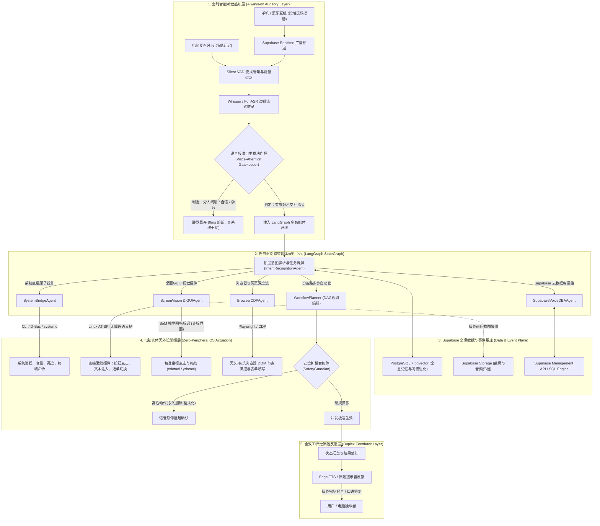

# 基于 Supabase 与 LangGraph 的全语音免外设电脑控制多智能体系统 (Voice-Native Autonomous OS Multi-Agent System)

## 一、 系统愿景与核心痛点突破

本系统旨在构建一套**彻底脱离鼠标、键盘与触摸板**的下一代计算机交互操作系统。用户仅凭自然口语，即可完成从日常系统操作、第三方桌面软件与网页控制，到复杂多步科研/工程工作流的端到端执行。

### 核心痛点与攻坚策略

| 传统语音助手的致命痛点 | 本系统的根治性架构方案 |
| :--- | :--- |
| **1. 机械式唤醒词打断思维**<br>每次下指令前都必须先喊一次“Siri”或“小爱同学”，无法进行人机连续自然对话。 | **无唤醒词自主注意门控 (Wake-Wordless Attention Gating)**：全时低功耗流式监听，结合声学特征与语用指称判定，自主裁决该语音是否属于发给电脑的指令。 |
| **2. 误触发与误操作频发**<br>若不设唤醒词，人在旁边聊天、自言自语、咳嗽或电脑放视频时，助手会误当成指令乱操作电脑。 | **语用指称性与连续倾听状态机 (Pragmatic Addressing Filter & Session State Machine)**：基于二分类轻量判别模型与对话活跃窗口（Active Window），精准阻断环境杂音与侧边交谈。 |
| **3. 只能控制几个固定功能**<br>仅支持“调大音量”、“关机”、“打开计算器”等死板硬编码命令，无法操作复杂第三方软件。 | **OS 全局控件语义树 + 视觉标记双轨制 (AT-SPI / Accessibility Tree + Set-of-Mark)**：直接寻址软件底层控件，免鼠标精准点击、填值、换页与快捷键编排。 |
| **4. 必须坐在电脑面前**<br>距离电脑稍远或在外移动时无法控制。 | **Supabase Realtime 跨端协同总线**：用户戴着蓝牙耳机在房间漫游，或通过手机端发送语音，跨网络毫秒级穿透控制主机执行。 |
| **5. 云端服务与数据库操作依然依赖键鼠**<br>开发者管理数据库仍需打开浏览器控制台用鼠标敲 SQL。 | **Supabase Voice DBA 深度直控**：用口语直接创建表、改字段、加索引、查慢查询、配置 RLS 安全策略。 |

---

## 二、 总体架构拓扑图



---

## 三、 核心技术模块详述

### 1. 语音自主接收裁决门控 (Voice-Attention Gatekeeper)

系统实现“无需喊唤醒词”同时“绝不把闲聊当指令”的核心算法由三道过滤防线构成：

#### 1.1 第一道：声学物理门限（Acoustic & VAD Filter）
* **回声消除（Acoustic Echo Cancellation, AEC）**：将电脑正在播放的扬声器音频（视频、音乐、系统提示音）与麦克风输入信号实时做差分对冲，杜绝电脑自己说的话被自己转录。
* **能量与时长有效性检测**：滤除短于 300ms 的爆破音（咳嗽、打喷嚏、椅轮滑动声）。

#### 1.2 第二道：语用指称性与动作导向判别（Addressing & Imperative Filter）
对转录文本进行高并发毫秒级二分类，计算指令置信度 $P(\text{IsCommand})$：
* **强指令特征（接收）**：
  * 具备操作性动词（`打开`、`关闭`、`搜索`、`运行`、`点击`、`切换`、`帮我`、`查看`、`发给`）；
  * 具备指示代词与宾语（`这个窗口`、`第三个标签`、`刚才下载的论文`、`左边那个`）；
  * 具备明确提问结构（`...怎么推导`、`...是什么意思`、`...报错原因`）。
* **非交互特征（丢弃）**：
  * 感叹词/语气词为主（`哈哈`、`对对对`、`没准吧`、`我去`）；
  * 纯人际对话称谓（`老李啊`、`妈，今天晚上吃啥`、`跟你们说个事`）；
  * 自言自语不完整短语。

#### 1.3 第三道：连续交互动态倾听窗口（Interactive Session Window）
* **STANDBY（静默守候态）**：阈值严格设为 $P \ge 0.85$；
* **ACTIVE_WINDOW（交互活跃态）**：一旦执行了一条指令，系统进入为期 **10 秒的连续倾听窗口**，阈值放宽至 $P \ge 0.40$。此时任何短追问（如“继续”、“往下拉一点”、“确定”、“换个思路”）均可直接触发，完全符合人类自然交谈习惯。任务终结或 10 秒无声后，平滑衰退回 STANDBY。

---

### 2. 纯语音免外设的“电脑控制执行矩阵”

彻底抛弃鼠标、键盘的关键是**建立“语义寻址为主、视觉标记为辅”的双轨机制**：

#### 2.1 主轨：Linux AT-SPI / Windows UI Automation 语义控件树（90% 场景）
* 鼠标点击本质上是为了告诉操作系统“我激活了哪个控件”。
* 智能体直接调用操作系统的无障碍辅助接口（Linux 下为 `python-atspi` 或 `at-spi2-core`），将当前屏幕解析为一棵标准的 JSON 语义树：
  ```json
  {
    "role": "push_button",
    "name": "发送",
    "states": ["focusable", "visible"],
    "action": "click"
  }
  ```
* **执行方式**：智能体直接向该控件节点注入 `action.doAction(0)` 事件。无论窗口被拖到哪个屏幕角落、分辨率是多少，均能 100% 毫秒级直接触发，无需任何鼠标移动轨迹。

#### 2.2 辅轨：Set-of-Mark (SoM) 视觉标记网格（10% 非标界面兜底）
* 当遇到无语义树的非标准自绘应用（如专业工业绘图软件、游戏界面或自绘界面）：
* 智能体在后台截取当前屏幕，对交互元素框进行标注，生成带半透明编号徽章的视觉网格图；
* 用户口述“点击 4 号框”、“把 2 号滑块向右拖”，智能体映射为底层模拟输入（`ydotool` / `xdotool` / `uinput`）进行像素级控制。

#### 2.3 底层总线直连（SystemBridgeAgent）
* 常见系统操作完全绕开图形界面：
  * **媒体与音量**：通过 Linux PulseAudio/ALSA（`pactl set-sink-volume @DEFAULT_SINK@ +10%`）；
  * **窗口管理**：通过 `wmctrl` / `xdotool` / Wayland IPC（`wmctrl -a "Visual Studio Code"` 毫秒级瞬切）；
  * **应用生命周期**：直接调用 `subprocess`、`systemctl` 或 D-Bus，避免手动寻找桌面图标。

---

### 3. Supabase 作为全息底座的四大赋能

#### 3.1 Supabase Realtime：跨设备“漫游耳机/手机遥控”
* 在手机端（PWA 或小程序）或智能手表上接入 Supabase Realtime Channel。
* 用户在外走动时，对手机或蓝牙耳机说：“*电脑上把刚才跑的训练日志导出一份简报*”；
* 音频流/文本经 Supabase Realtime 广播推送到电脑主机的后台守护进程，电脑即刻执行，并通过 Realtime 将结果文本或合成语音回传到耳机，实现**真正的无界人机协同**。

#### 3.2 PostgreSQL + pgvector：操作轨迹与长期习惯进化
* 记录用户的习惯别名映射（例如：用户说“打开我的主力工程”，系统学习并固化为启动 VS Code 打开指定路径 + 拉起 Docker 环境）；
* 利用 **pgvector** 对每次执行的指令与报错上下文建立向量索引，遇到相似的编译或运行报错时，自动推荐并执行此前验证过的修复策略。

#### 3.3 Supabase Storage：操作闭环“黑匣子”
* 每次关键 UI 动作执行前后自动抓取屏幕存入 Storage（`action_before.png` 与 `action_after.png`）；
* 视觉智能体比对两张图片，判断页面是否按预期产生了状态改变，确保盲操闭环可靠。

#### 3.4 Supabase Voice DBA：免键鼠云端数据库与运维
* 口语指令直接映射为安全 SQL 与迁移：
  * *“在 Supabase 知识库表里加一个 tag 字段”* $\to$ 智能体自动执行 Migration；
  * *“查一下过去半小时写入最多的是哪个表”* $\to$ 智能体调用 SQL Engine 并语音汇报；
  * *“给 users 表加上行级安全策略 RLS”* $\to$ 智能体生成标准 PostgreSQL RLS 策略代码。

---

## 四、 目录文件结构与职责划分

```
voice_os_agent/
├── ARCHITECTURE_AND_DESIGN.md      # 本架构全景设计说明书
├── voice_attention_gatekeeper.py   # 核心：自主裁决是否接收语音的门控状态机
├── voice_langgraph_agent.py        # 基于 LangGraph 的流式听觉感知图
├── smart_audio_transcriber.py      # Silero VAD + Whisper 本地极速转录引擎
├── auto_transcriber.py             # 硬件麦克风/声卡流式采集守护模块
├── supabase_integration.py         # Supabase 实时总线、pgvector记忆与DBA直控套件
├── main_daemon.py                  # 系统后台主驻留进程 (监听 -> 门控 -> 规划 -> 执行)
└── .env.example                    # 环境变量配置模板
```

---

## 五、 安全熔断机制 (Safety Guardian)

在彻底解放双手的全语音环境中，为防止系统误解指令导致破坏性后果，设立**三色操作安全分级**：

1. **绿色操作（直接极速放行）**：
   * 音量/亮度调节、窗口切换、打开软件、网页浏览、文档检索、纯知识研讨推导。
2. **黄色操作（动作即广播，支持口语打断）**：
   * 提交表单、发送即时通讯消息、创建新文件、执行非破坏性脚本。
   * 系统在执行前发出轻快提示音并伴随播报：“*正在向工作群发送报告*”，若用户在 2 秒内喊出“*等等*”或“*取消*”，动作立即挂起回滚。
3. **红色操作（强制语音挂起确认）**：
   * 删除文件（`rm`）、格式化磁盘、清空数据库表、关闭未保存代码。
   * 系统强制中断执行链条，主动发问：“*检测到该操作将删除当前目录全部文件，请口头确认是否执行？*”，必须收到“*确认执行*”口令方可推进。
